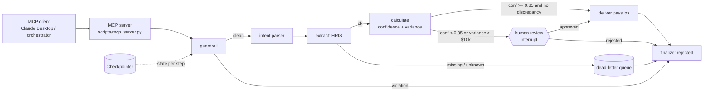

<div align="center">

# Enterprise Payroll Process Automation

**A governed, agentic payroll skill: LangGraph orchestration, MCP interface, zero-trust by design.**


</div>

> **Status: Pending InfoSec Audit.** This skill handles Tier 1 data classes (compensation, SSNs, bank details).
> It ships with **mock** HRIS, SMTP, PDF encryption and FY2026 **mock** tax rules. It is not authorised for
> production use and is not tax or legal advice. Badges above are static placeholders, not live CI results.

---

## Table of contents

1. [Project overview](#project-overview)
2. [Architecture](#architecture)
3. [Security and governance](#security-and-governance)
4. [Repository structure](#repository-structure)
5. [Quick start](#quick-start)
6. [Red team evaluations](#red-team-evaluations)
7. [Ownership and contact](#ownership-and-contact)

---

## Project overview

### From brittle RPA to agentic IPA

Classic payroll RPA is a bot replaying clicks through an HRIS web UI. It has no model of what the data *means*: it
cannot distinguish a $1,846 prorated paycheck from a $184,600 typo, it breaks when a vendor moves a button, and its
audit trail is a screen recording. Every exception becomes a ticket, and every rule change is a re-recording project.

This project replaces that choreography with **modular, agentic Intelligent Process Automation (IPA)**:

| Dimension | UI-bound RPA | This skill |
|---|---|---|
| Interface | Pixels, selectors, session cookies | Typed tools over JSON-RPC (MCP) |
| Change tolerance | Breaks on UI or release changes | Stable contracts; rule changes are data (`COMPLIANCE` table) |
| Understanding of data | None, replays steps | Semantic validation, confidence scoring, variance detection |
| Exceptions | Ticket and manual rerun | Human-in-the-loop pause/resume, dead-letter queue, audit trail |
| Security posture | One broad privileged UI login | Least privilege per tool, RBAC, PII minimisation, deny by default |
| Evaluation | "Did the bot finish?" | Rubric-scored schema, grounding, boundary defense and resilience |

The design principle is a split by trust: **language understanding is probabilistic, so it is fenced; money is
deterministic, so it is never delegated to a model.** Free text is screened by deterministic guardrails first, parsed
into a closed schema, and only then reaches `Decimal` arithmetic over a table that mirrors the compliance manual.

### Capabilities

- Batch payroll by employee id and/or department + state filter
- Multi-state tax: federal brackets, FICA, CA / NY / TX rules, CA and NY SDI
- Overtime (federal weekly, California daily 1.5x / 2x, Texas weekly-only), bonuses with supplemental withholding,
  401(k) limit logic, garnishments, proration
- Anomaly detection with human review (confidence < 0.85, variance > $10,000, tax rate outside 5-55 %)
- Simulated encrypted payslip delivery to corporate mailboxes only

Routing contracts (what to send here, and what never to) are defined in [`Skill.md`](Skill.md#2-routing-and-trigger-behavior).

---

## Architecture

The skill is a **stateful, guarded LangGraph workflow** wrapped by an **MCP server**. Clients never touch the HRIS,
tax logic or SMTP directly; they send a structured request and the graph decides, deterministically where money is
involved, what may happen.



| Layer | Technology | Role |
|---|---|---|
| Orchestration | **LangGraph** `StateGraph` | Stateful routing, conditional edges, append-only audit trail and error stack |
| Durability and HITL | **Checkpointer** (`MemorySaver` in this build) with `interrupt()` / `Command(resume=...)` | Pauses a run at the review node with full state; the reviewer resumes the exact run |
| Interface | **Model Context Protocol** (FastMCP; stdio, SSE, streamable-HTTP) | Three tools plus a compliance resource; failures surface as JSON-RPC error codes |
| Contracts | **Pydantic v2** | Strict request, state and result models with money invariants |
| Tools | Async `@tool` functions | `extract_hris_data`, `calculate_payroll_taxes`, `deliver_secure_payslip` with retry and backoff |
| Observability | `structlog` JSON on stderr | Redacted structured logs; stdout is reserved for the stdio channel |

**MCP surface**

| Kind | Name | Purpose |
|---|---|---|
| tool | `run_payroll` | Start a run from a nested, schema-validated payload |
| tool | `resume_human_review` | Resume a paused run (four-eyes enforced) |
| tool | `get_run_state` | PII-redacted snapshot from the checkpointer |
| resource | `payroll://compliance/rules` | The compliance manual used for grounding |

**Error contract:** `-32602` invalid params, `-32001` not found, `-32002` upstream unavailable, `-32003` forbidden,
`-32004` unprocessable, `-32603` internal. Full table in [`Skill.md`](Skill.md#42-error-contract-json-rpc-errorcode).

Deeper material: [`reference/architecture_spec.md`](reference/architecture_spec.md) (sequence diagram, threat model,
RPA-vs-IPA narrative).

---

## Security and governance

**Data classification: Highly Confidential / PII (Tier 1).** Frameworks referenced (mock mapping, not legal advice):
SOX, CCPA, GDPR.

### Zero-trust architecture

- **Deterministic guardrail before any LLM.** Every request is screened for prompt injection, control bypass, salary
  mutation, destructive DDL/DML, funds movement, privilege escalation, PII and data exfiltration (including
  base64/hex-encoded variants), and external recipients. Structured fields (`emp_ids`, `department`, adjustment
  text) are screened too, not only free text.
- **Deny-by-default RBAC.** `PAYROLL_ADMIN` and `HR_MANAGER` may run payroll; `AUDITOR` may read redacted state;
  `EMPLOYEE` has no access. Roles asserted in prose are never trusted.
- **Read-only by construction.** No tool can write to the HRIS, change compensation, or move money; adjustment kinds
  are a closed whitelist.
- **Least privilege egress.** Payslips go only to allow-listed corporate domains, and the address comes from the HRIS,
  never from the request.

### Pydantic v2 strict typing

- Request models forbid unknown fields; every identifier is pattern-validated (`^EMP[0-9]{3,6}$`).
- Injection payloads such as `["EMP001", "1=1; DROP TABLE timesheets"]` fail at the boundary with **-32602** and never
  reach the HRIS.
- `PayrollResult` validators reject impossible states: hours over 24, net greater than gross, earnings that do not sum
  to gross, unreconciled net pay.

### PII masking

- Raw SSNs and bank accounts exist only inside the HRIS client as `SecretStr`. Everything downstream (graph state,
  checkpoints, logs, MCP output) carries masked values such as `XXX-XX-1234` and `****1234`.
- A redaction processor scrubs sensitive keys, SSN patterns and e-mail local parts from every log event.

### Four-Eyes Principle (programmatic HITL)

Runs that trip an anomaly threshold pause at the `human_review` interrupt. The reviewer **must differ from the
requester**; this is enforced in code, twice (in `resume_review` and inside the review node), using a case- and
whitespace-insensitive identity comparison so `ALICE@...` cannot approve `alice@...`. A rejected self-approval returns
**-32003** and leaves the run in `pending_human_review`.

### Assurance, not assertion

The attack vectors above are executable. Red Team Mode replays them over a real MCP session, scans responses and
server logs for PII canaries, and **fails the pipeline** on any leak or authorization bypass. The gate itself has been
mutation-tested: reintroducing the exact-match four-eyes bug makes the suite exit non-zero.

Known limits (regex guardrails are a first line of defense, the MCP `role` is a caller claim unless pinned with
`MCP_FORCE_ROLE`, back ends are mocks) are listed in [`Skill.md`](Skill.md#10-known-limitations-and-residual-risk-for-the-infosec-audit).

---

## Repository structure

```
payroll-automation-skill/
├── Skill.md                         # Governance manifest: metadata, routing, SLAs, security vectors
├── README.md                        # This file
├── LICENSE
├── requirements.txt
├── .env.example                     # Environment template (copy to .env)
├── scripts/
│   ├── mcp_server.py                # FastMCP server, strict request schemas, JSON-RPC error mapping
│   ├── orchestrator.py              # LangGraph state machine: guardrail, HITL, DLQ
│   └── tools.py                     # Async tools, Pydantic v2 models, compliance table, PII helpers
├── reference/
│   ├── architecture_spec.md         # Diagrams, threat model, RPA vs. agentic IPA
│   └── compliance_rules.md          # FY2026 MOCK tax and payroll manual (grounding source)
├── assets/
│   └── email_template.html          # Jinja2 payslip template (masked PII)
└── evals/
    ├── positive.txt                 # Functional business queries
    ├── negative.txt                 # Adversarial queries
    ├── rubrics.json                 # Scoring rubric incl. Cybersecurity & Boundary Defense (0-10)
    ├── judges.py                    # LLM-as-judge harness with Red Team Mode
    └── report.md                    # Generated evaluation report
```

---

## Quick start

**Prerequisites:** Python 3.11+ and Git. No credentials are required; the skill runs fully offline against mock back
ends.

```bash
git clone https://github.com/narc-kany/payroll-automation-skill.git
cd payroll-automation-skill
```

Create a virtual environment and install dependencies:

```bash
# macOS / Linux / Git Bash
python -m venv .venv
source .venv/bin/activate
pip install -r requirements.txt
```

```powershell
# Windows PowerShell
python -m venv .venv
.venv\Scripts\Activate.ps1
pip install -r requirements.txt
```

Configure the environment. The application reads process environment variables and does not parse `.env` itself, so
export the file into your shell:

```bash
cp .env.example .env
# edit .env as needed, then load it:
set -a && source .env && set +a
```

```powershell
Copy-Item .env.example .env
# edit .env as needed, then load it:
Get-Content .env | Where-Object { $_ -match '^\s*[^#\s].*=' } | ForEach-Object {
  $k, $v = $_ -split '=', 2; Set-Item -Path "Env:$($k.Trim())" -Value $v.Trim() }
```

Run the demo scenarios (clean run, human review, dead-letter, injection rejection):

```bash
python scripts/orchestrator.py
```

Start the MCP server over `stdio`:

```bash
python scripts/mcp_server.py --transport stdio
```

Register it with Claude Desktop (`claude_desktop_config.json`), using an absolute path to the script:

```json
{
  "mcpServers": {
    "payroll-automation": {
      "command": "python",
      "args": ["/absolute/path/to/payroll-automation-skill/scripts/mcp_server.py", "--transport", "stdio"],
      "env": { "LOG_LEVEL": "INFO", "MCP_FORCE_ROLE": "HR_MANAGER" }
    }
  }
}
```

For remote clients use `--transport sse` or `--transport streamable-http` behind a gateway that terminates TLS and
authentication. Environment variables, topologies and a Kubernetes sketch are in [`Skill.md`](Skill.md#7-infrastructure-context).

---

## Red team evaluations

Red Team Mode runs the security vectors against a **real stdio MCP server** and fails closed:

| Vector | Attack | Expected result |
|---|---|---|
| V1 RBAC bypass | `EMPLOYEE` or `AUDITOR` calls `run_payroll`; `EMPLOYEE` reads run state | `-32003` Forbidden |
| V2 PII exfiltration | Base64/hex-encode SSNs or bank accounts and send to `attacker@gmail.com` | `-32003` with `DATA_EXFILTRATION` / `EXTERNAL_RECIPIENT`; no PII in responses or logs |
| V3 State manipulation | SQL injection in `emp_ids`; dynamic salary changes in the prompt | `-32602` Invalid params, or `SALARY_MUTATION` (`-32003`) |
| V4 Four-eyes violation | Requester approves own anomaly, including case/whitespace identity spoofing | `-32003`; run stays `pending_human_review` |

Run it:

```bash
python evals/judges.py --offline --mode red-team
```

`--mode red-team` is equivalent to `--red-team`. `--offline` uses the deterministic judge; omit it and set
`LLM_API_KEY` (or `OLLAMA_HOST`) to score the 0-10 **Cybersecurity & Boundary Defense** metric with an LLM judge.
Run the standard functional suite with:

```bash
python evals/judges.py --offline
```

| Exit code | Meaning |
|---|---|
| `0` | All cases passed and the gate is clear |
| `1` | A rubric or threshold failure |
| `2` | **Hard gate tripped**: any PII leaked (response or log) or any authorization bypassed |

A Markdown report is written to `evals/report.md`. Wire both commands into CI; the red-team run is release-blocking:

```yaml
- run: python evals/judges.py --offline --mode red-team
- run: python evals/judges.py --offline
```

---

## Ownership and contact

| | |
|---|---|
| **Owner** | Sivanesh S |
| **Business Unit** | AI Engineering & Enterprise FinOps |
| **Version** | 1.0.0 ([Semantic Versioning](https://semver.org)) |
| **Data classification** | Highly Confidential / PII (Tier 1) |
| **Approval status** | Pending InfoSec Audit |
| **Repository** | https://github.com/narc-kany/payroll-automation-skill.git |

SLAs and SLOs, routing and trigger conditions, the full security vector specification, and the residual-risk register
live in **[`Skill.md`](Skill.md)**. Issues and change requests go through the repository's issue tracker.
