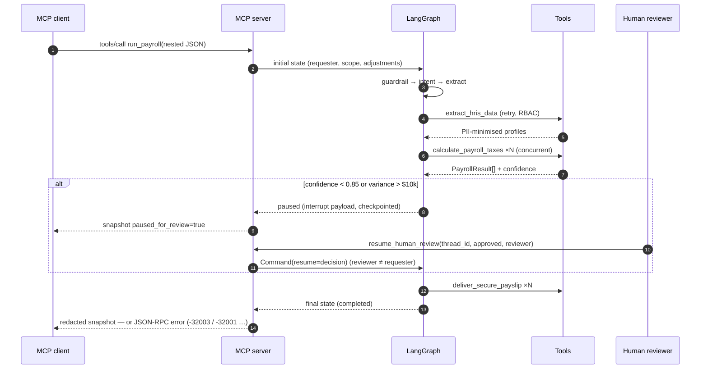

# Architecture Specification — Enterprise Payroll Automation Skill

## 1. System overview

The skill is a **stateful, guarded LangGraph workflow** wrapped by an **MCP server**. External LLMs and
orchestrators (Claude Desktop, enterprise agents) never touch HRIS, tax logic or SMTP directly: they send a
structured JSON-RPC request, and the graph decides — deterministically where money is involved — what may happen.

```mermaid
flowchart LR
    subgraph Clients["Enterprise LLM clients"]
        CD[Claude Desktop]
        EO[Enterprise orchestrator]
    end

    subgraph MCP["MCP bridge  (scripts/mcp_server.py)"]
        direction TB
        T1["tool: run_payroll"]
        T2["tool: resume_human_review"]
        T3["tool: get_run_state"]
        R1["resource: compliance rules"]
        EM["Error mapper<br/>→ JSON-RPC codes"]
    end

    subgraph Graph["LangGraph workflow  (scripts/orchestrator.py)"]
        direction TB
        G[guardrail_node<br/>injection · RBAC · DLP]
        P[intent_parser_node<br/>rules + optional LLM<br/>schema-validated]
        X[extract_node]
        C[calculate_node<br/>confidence + variance]
        H{{human_review_node<br/>interrupt - HITL}}
        D[deliver_node]
        Q[(dead_letter_queue)]
        F[finalize_node]
        CP[(Checkpointer<br/>MemorySaver / Postgres)]
        G -- clean --> P --> X
        G -- violation --> F
        X -- ok --> C
        X -- missing / not found --> Q
        X -- access denied --> F
        C -- "conf ≥ 0.85 and no discrepancy" --> D
        C -- "conf < 0.85 or Δ > $10k" --> H
        C -- anomaly --> Q
        H -- approved --> D
        H -- rejected --> F
        D --> F
        Q --> F
        Graph -.state per step.-> CP
    end

    subgraph Tools["Tool boundary  (scripts/tools.py, @tool + Pydantic v2)"]
        direction TB
        E1[extract_hris_data<br/>async · retry · RBAC]
        E2[calculate_payroll_taxes<br/>Decimal · compliance table]
        E3[deliver_secure_payslip<br/>render · encrypt · SMTP]
    end

    subgraph Backends["Systems (mocked)"]
        HR[(HRIS<br/>PostgreSQL / Workday)]
        SM[SMTP relay]
        LL[LLM via litellm<br/>optional]
    end

    CD --> T1 & T2 & T3
    EO --> T1
    T1 & T2 & T3 --> Graph
    T1 & T2 & T3 -.errors.-> EM
    X --> E1 --> HR
    C --> E2
    D --> E3 --> SM
    P -.optional.-> LL
    E2 -.cites.-> CR[(compliance_rules.md)]
```

### Request lifecycle



## 2. Design principles and where they live

| Principle | Mechanism |
|---|---|
| **Zero trust** | Deterministic guardrail runs *before* any LLM; roles checked at the graph entry and again inside tools; executives require `PAYROLL_ADMIN`; LLM output must validate against a closed `ParsedIntent` schema. |
| **PII minimisation** | Raw SSN / bank data exist only in `EmployeeRecord` (`SecretStr`) inside the HRIS client. Everything downstream — graph state, checkpoints, logs, MCP output — carries `XXX-XX-1234` / `****1234`, enforced again by `redact_pii`. |
| **Strict contracts** | Pydantic v2 `@model_validator`s reject impossible states (hours > 24, net > gross, earnings ≠ gross, unreconciled net, hired-after-period). |
| **Deterministic money** | `Decimal` + half-up rounding; every rate comes from `COMPLIANCE`, which mirrors `compliance_rules.md`; each result lists the `§` sections it used. |
| **Async & scalable** | All I/O is `async`; per-employee extraction and calculation run under `asyncio.gather`; retries use exponential backoff with jitter. |
| **Durable state + HITL** | Graph compiled with a checkpointer; `interrupt()` pauses, `Command(resume=…)` continues; four-eyes check in `resume_review`. |
| **Fail safe** | Any missing critical datum sends the *whole batch* to the dead-letter queue — no partial payroll. |
| **Observability** | JSON logs (structlog) with an audit trail entry per node stored in state and returned to callers. |

### State model

`PayrollState` (TypedDict): `request_id`, `requester_id`, `requester_role`, `query`, `emp_id`, `emp_ids`,
`adjustments`, `period`, `financial_context` (profiles / results / receipts / review reasons),
`confidence_score`, `status`, `review`, `audit_trail` (append-only), `error_stack` (append-only), `summary`.
Only JSON-compatible values are stored so any checkpointer can serialise them.

## 3. Threat model (abridged)

| Threat | Control | Evidence |
|---|---|---|
| Prompt injection in the query or adjustment notes | Regex guardrail precedes LLM; LLM only fills a closed schema; user text is passed as data | `evals/negative.txt` #1 |
| Salary / bank mutation | No write tool exists; whitelisted adjustment kinds; guardrail | #2 |
| Destructive DDL/DML | Guardrail + read-only HRIS role | #3 |
| Funds movement / approval bypass | Anti-goal; guardrail `FUNDS_MOVEMENT`, `CONTROL_BYPASS` | #4 |
| Privilege escalation / PII dump | Role from authenticated context, not prose; `PII_EXFILTRATION` | #5 |
| Exfiltration via payslip | Recipient domain allow-list; address comes from HRIS, never from the request | `deliver_secure_payslip` |
| Self-approval | Reviewer ≠ requester enforced in `resume_review` and in the node | MCP smoke test |
| Log leakage | `redact_pii` in every log event and snapshot | `tools.redact_pii` |

Known limits of this reference implementation: regex guardrails are a first line, not a complete defence (pair
with model-based classifiers and gateway DLP in production); the checkpointer, DLQ, HRIS, SMTP and PDF
encryption are mocks (`_mock_encrypt` is a demo stand-in, not cryptography); tax data is FY2026 *mock*.

## 4. RPA vs. agentic Intelligent Process Automation

### The brittle world of UI-bound RPA

Classic RPA automates payroll the way an intern would: a bot logs into the HRIS web UI, scrapes timesheet grids by
pixel coordinates or CSS selectors, pastes numbers into a tax-engine screen, and clicks "Send". It works until the
vendor moves a button, a modal appears that nobody scripted, or a column is renamed during a quarterly release.
Because the bot has no model of *what the data means*, it cannot tell a $1,846 prorated paycheck from a $184,600
typo — it replays keystrokes either way. Every exception becomes a ticket; every rule change (California daily
overtime, a new wage base) becomes a re-recording project. Worse for compliance, a bot that holds a privileged UI
session is an all-or-nothing credential: it can do anything the UI allows, and its audit trail is a screen recording.

### What changes with agentic IPA

This skill replaces screen-scraping with **typed contracts and semantic intent**. A request such as "prorate EMP007
as they joined mid-cycle" is understood as an intent, validated into a closed `Adjustment` schema, and executed by a
tool that knows what proration *means* under §2.3 of the manual. The stack is deliberately split by trust:

- **Language understanding is probabilistic, so it is fenced.** Free text is screened first, parsed into a
  schema-bound intent, and can never reach a code path that was not whitelisted.
- **Money is deterministic, so it is not delegated to a model.** Tax math is `Decimal` arithmetic over a table that
  mirrors the compliance manual; the model cannot "round creatively". Every line cites the section it came from,
  which is exactly what an LLM judge (or an auditor) needs to verify grounding.
- **Judgement is routed to people at the right moment.** Instead of a bot that either completes or crashes, the
  graph computes confidence and variance and *pauses* — with full state checkpointed — when a human should look.
  The reviewer resumes the exact run; nothing is re-keyed.
- **Failure is a first-class outcome.** Missing data, unknown employees and anomalies end in a dead-letter queue with
  an audit trail, not in a half-processed batch.
- **Integration is a protocol, not a screen.** MCP gives any compliant client the same three tools, JSON-RPC error
  codes and a resource carrying the rulebook, so the capability is reusable across assistants without per-UI bots.

| Dimension | UI-bound RPA | This agentic IPA skill |
|---|---|---|
| Interface | Pixels, selectors, session cookies | Typed tools, JSON-RPC, MCP |
| Change tolerance | Breaks on UI/release changes | Stable contracts; rule changes are data (`COMPLIANCE`) |
| Understanding of data | None — replays steps | Semantic validation (`@model_validator`), anomaly scoring |
| Exceptions | Ticket + manual rerun | HITL pause/resume, DLQ, audit trail |
| Security posture | Broad privileged UI login | Least privilege per tool, RBAC, PII minimisation, deny-by-default |
| Auditability | Screen recordings | Per-node structured audit + section citations |
| Evaluation | "Did the bot finish?" | Rubric-scored schema, grounding, boundary defence and resilience |

The point is not that agents replace controls — it is that they let the controls live in code, schemas and
protocols where they can be tested (`evals/`), instead of in the fragile choreography of a click-path.
